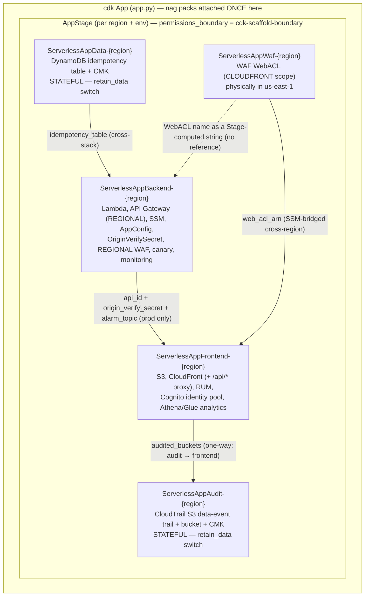
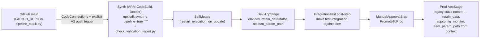
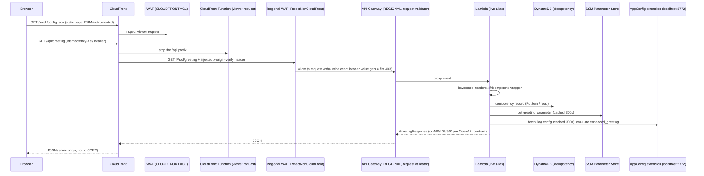
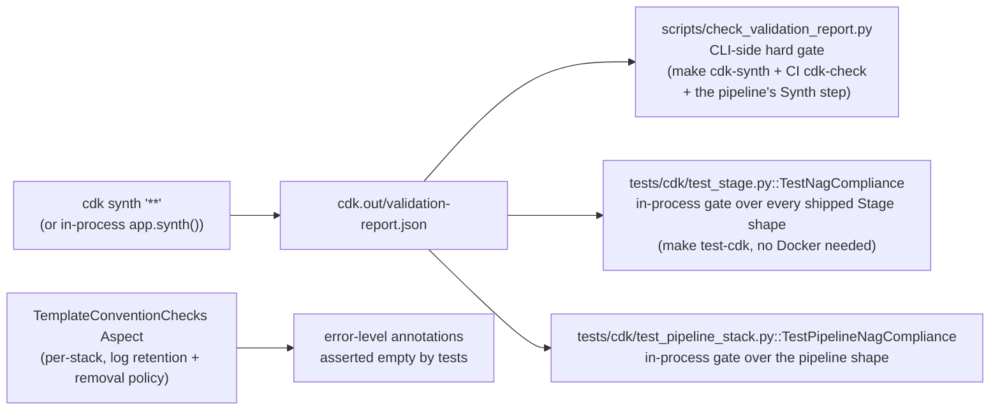

# System Architecture

How the five CDK stacks compose into one deployable unit, how the optional CD pipeline wraps that unit, how requests flow at runtime, and the design principles that hold the template together.

## Deployment topology

All five stacks live inside `AppStage` (a `cdk.Stage`). `app.py` is mode-switched: in **direct mode** (the default) it instantiates one `AppStage` per region + environment pair; in **pipeline mode** (`-c pipeline=true`) it instead synthesizes `PipelineStack` (`ServerlessAppPipeline`), which embeds `AppStage` twice — `Dev` (env `dev`) and `Prod` (legacy prod names) — see [Pipeline mode](#pipeline-mode). The Stage makes "these stacks deploy together" structural, scopes the cloud assembly under `cdk.out/assembly-{stage}/`, and is the unit CDK Pipelines deploys.

Key topology rules (violating these breaks deploys or creates dependency cycles):

- **Stack names are pinned.** The default `prod` environment keeps legacy names (`ServerlessAppBackend-us-east-1` etc.). CloudFormation matches stacks by name; renaming orphans live deployments. Non-prod environments insert an env segment (`ServerlessAppBackend-{env}-{region}`). The pipeline's prod stage reuses the legacy names, so it adopts the existing prod stacks in place; `dev` is pipeline-reserved.
- **WAF is always us-east-1** (CloudFront-scoped WebACLs must live there). When the target region differs, `cross_region_references=True` on the frontend stack bridges the ACL ARN through SSM automatically.
- **Audit → frontend is one-way.** The trail and its bucket are inseparable (the bucket policy references the trail ARN), so they live together in `AuditStack`; the buckets the trail merely *audits* stay in the frontend stack and are passed in. Moving either piece reintroduces a cycle.
- **The Stage computes deterministic names as strings** (account pseudo-parameter only) instead of passing construct references: the WAF log S3 locations for the frontend's Glue tables, and the CloudFront WebACL name (`{waf_stack_name}-cf`) that the backend's BlockedRequests alarm addresses by name — deliberately avoiding cross-region cross-stack references.
- **The permissions boundary is mandatory.** `AppStage` and `PipelineStack` both pass `permissions_boundary=SCAFFOLD_PERMISSIONS_BOUNDARY` (one shared descriptor in `app_stage.py`) unconditionally. The `cdk-scaffold-boundary` managed policy must already exist (`make bootstrap-boundary`), or every role fails at deploy with an IAM error. A boundary-blocked permission surfaces at deploy or runtime — never at synth.
- **The backend region must resolve an AppConfig extension layer.** `APPCONFIG_EXTENSION_ARM64_LAYER_ARNS` in `appconfig_extension.py` pins the arm64 layer for every region in AWS's table (2.0.22365; `me-central-1`/`me-south-1` at 2.0.18836), keyed by the stack's deploy region. Resolution: `-c appconfig_extension_layer_arn` → `APPCONFIG_EXTENSION_LAYER_ARN` env var → map → `ValueError`; an override must be in the stack's region and that region's partition, emits a synth warning naming the ARN (backend stack, and `PipelineStack` in pipeline mode), and a token region fails loudly.

## Pipeline mode

`-c pipeline=true` makes `app.py` synthesize `PipelineStack` (`infrastructure/pipeline_stack.py`): a self-mutating CDK Pipelines `pipelines.CodePipeline` over an underlying V2 `codepipeline.Pipeline` named `ServerlessAppPipeline`. Pipeline mode needs `CDK_DEFAULT_ACCOUNT` at synth (CDK Pipelines deploys concrete environments), needs a CodeConnections ARN (`code_connection_arn` context key, else the `CODE_CONNECTION_ARN` env var; validated by `validate_code_connection_arn`), and rejects any `-c env` value outright — the pipeline owns its environments.

Pipeline rules (each was live-proven in part-two; README "CI/CD pipeline" is the authoritative runbook):

- **Push-to-deploy is a matched pair plus a GitHub-side precondition.** CDK synthesizes a V2 pipeline with no `Triggers` block, and V2 does not inherit V1's connection-based change detection. `_declare_push_trigger` adds the git push trigger as a CFN property override (it must run after `build_pipeline()`, because the source action does not exist before then), and the source sets `trigger_on_push=False` (`DetectChanges: false`) because legacy detection and the V2 trigger are mutually exclusive routing modes. Outside anything CDK can pin, the AWS Connector for GitHub app must be **installed** with this repo granted — an authorized-only app reads the public repo fine but delivers zero push events.
- **The connection ARN is never committed.** The workstation birth deploy (`make deploy-pipeline`) passes it as `-c code_connection_arn`; the Synth step carries it as the `CODE_CONNECTION_ARN` CodeBuild env var, which `app.py` falls back to on every self-mutation synth.
- **ARM CodeBuild fleet** (`LinuxArmBuildImage.AMAZON_LINUX_2023_STANDARD_3_0`, `docker_enabled_for_synth=True`): `PythonFunction` bundles arm64 images, which an x86 CodeBuild host cannot execute.
- **Own CMK and CFN-owned build logs**: `PipelineKey` encrypts the artifact bucket (90-day expiry) and the single `PipelineBuildLogs` group (90-day retention) handed to every generated CodeBuild project — otherwise CodeBuild auto-creates never-expire log groups outside CloudFormation.
- **Least-scope integration step**: the `IntegrationTest` role may only `cloudformation:DescribeStacks` on the two dev stack ARNs; it exports the dev stack names, which win over pyproject's `D:`-prefixed pytest-env defaults.
- **Nag acknowledgments are shape-sensitive**: `_acknowledge_pipeline_findings` lists the CDK-Pipelines-generated IAM5 finding ids in both partition renderings (`<AWS::Partition>` for in-process tests, literal `aws` for CLI synth with `enablePartitionLiterals`), and some ids embed logical-id hashes that change if the stage/step tree is reshaped.
- **Push before any workstation `make deploy-pipeline`**: a workstation deploy restarts an execution that sources whatever `main` holds, so an unpushed definition change is silently reverted by SelfMutate.

## Runtime request flow

The handler is layered: `lambda/app.py` (HTTP boundary, Powertools wiring, error translation) → `lambda/service.py` (business logic, no AWS client state) → `lambda/models.py` (Pydantic contracts), with `lambda/extension_store.py` adapting the AppConfig Lambda extension's localhost endpoint (the extension polls AppConfig in the background, prefetching the profile at cold start) to Powertools' `StoreProvider` interface. The `EnvVars` model validates the environment at import time so misconfiguration fails the cold start, not the Nth request.

Same-origin consequences worth knowing: CORS machinery is gone entirely (no `CORSConfig`, no hand-built CORS headers); CloudFront does not strip the matched `/api/*` path pattern, so any new route under `/api/*` relies on the viewer-request rewrite plus the origin's fixed `origin_path="/Prod"`; and CloudFront's distribution-wide 403/404 → `index.html` mapping (the SPA fallback) also rewrites 403/404s coming back from the API origin, while the API's own 400/409/500 codes pass through. A direct `execute-api` caller is rejected fail-closed by the regional WAF — the integration suite asserts both paths.

## Compliance gating architecture

cdk-nag v3 rule packs are **policy-validation plugins** evaluated over the synthesized assembly — not per-stack Aspects. The CLI exit code is *not* the gate for Python apps (CDK sets `process.exitCode` in jsii's throwaway Node kernel, so `cdk synth` exits 0 with findings).

- Packs attach **once at the App root** (`attach_nag_packs` in `nag_utils.py`); `apply_compliance_aspects` runs per stack (including `PipelineStack`) and carries only the project's own Aspect plus cdk-nag's `WriteNagSuppressionsToCloudFormationAspect` (which must be per-stack because Aspects do not cross `cdk.Stage` boundaries).
- Findings are resolved by fixing the resource or acknowledging via `acknowledge_rules(construct, [{"id", "reason", "applies_to"}])` — the v2-shaped adapter onto v3's acknowledge API. Granular rules (IAM4/IAM5) need exact `Rule[Finding]` ids in `applies_to`; acknowledgments cover the whole construct subtree.
- A missing `validation-report.json` **fails** the CLI gate (packs not attached = broken gate, not a pass). In-process, the shared `_unacknowledged_findings` helper (`tests/cdk/test_stage.py`, reused by the pipeline test) treats a missing report as empty, so `test_nag_gate_can_fail` is the canary proving that gate is not vacuous.

## Encryption posture

Every data-bearing resource that supports a per-resource customer-managed key is CMK-encrypted, and keys are scoped per stack (never shared across stack boundaries) so each carries a least-privilege key policy:

| Stack | CMK scope |
|---|---|
| DataStack | DynamoDB table (key lives with the data it protects — retention is meaningless otherwise) |
| AuditStack | CloudTrail log files (per-object SSE-KMS into an SSE-S3 bucket) + trail log group |
| WafStack | S3 auto-delete provider log group |
| Backend | Lambda env vars, log groups, SNS alarm topic, AppConfig hosted config + deployment, `OriginVerifySecret` (Secrets Manager), SQS DLQs |
| Frontend | Asset bucket, RUM/provider log groups |
| PipelineStack (pipeline mode only) | Artifact bucket + the CFN-owned CodeBuild log group |

Service-principal grants on CMKs are confused-deputy-guarded with `aws:SourceAccount` + `aws:SourceArn` (see `grant_logs_service_to_key` / `grant_cloudtrail_service_to_key` in `nag_utils.py`). Exceptions: `grant_cloudwatch_alarms_to_key` and `grant_budgets_to_key` (the alarm and spend-budget publish paths into the CMK-encrypted SNS topic) use `aws:SourceAccount` + `kms:ViaService` and deliberately omit `aws:SourceArn` — neither service is documented to set it on via-SNS KMS calls, and an unmatched required condition would silently drop notifications. A service-principal key statement never matches calls a service makes through its assumed service-linked role, which is why the backend CMK deliberately carries no GuardDuty grant (a former one was live-proven dead policy). Account/region-wide encryption settings (X-Ray, Glue Data Catalog) are deliberately out of scope — they would mutate state shared with other apps in the account.

## Log routing: operational vs audit

- **Operational logs** → CloudWatch (Lambda, API Gateway access + execution) at 90-day retention; CDK-provider singletons at 7 days.
- **Audit/analytics logs** → S3 via the shared `create_sse_s3_log_bucket` helper: CloudFront access logs (7-day lifecycle), CloudTrail logs (90-day), and **two** WAF log buckets (90-day) — one in WafStack (us-east-1, CloudFront ACL) and one in the backend stack (target region, REGIONAL ACL), because the WAF→S3 destination must be in the ACL's region.
- WAF log buckets pre-declare the exact `delivery.logs.amazonaws.com` grant, and each `CfnLoggingConfiguration` is ordered after `bucket.policy` — otherwise WAF auto-attaches its own bucket policy and the deploy fails with "The bucket policy already exists".
- Both WAF logging configs share `waf_log_redacted_fields()` (scrubs `authorization`, `cookie`, and the `x-origin-verify` secret) and `WAF_LOG_DROP_ALLOW_FILTER` (drops ALLOW records, so log volume scales with threat traffic, not legitimate traffic).
- Athena + Glue partition-projected tables (CloudFront access logs, both WAF logs) plus named queries make the S3 sinks queryable.
- In pipeline mode, every generated CodeBuild project logs to the one CFN-owned, CMK-encrypted `PipelineBuildLogs` group (90 days).

## Deployment safety machinery

```mermaid
graph TB
    subgraph Code["Code deploys (always on)"]
        VER["Lambda version + live alias"] --> DG["CodeDeploy LambdaDeploymentGroup<br/>prod: CANARY_10PERCENT_5MINUTES<br/>dev: ALL_AT_ONCE"]
        DG --> ALARM1["canary alias-errors alarm<br/>DEPLOYMENT_STOP_ON_ALARM rollback"]
    end
    subgraph Flags["AppConfig flag deploys (opt-in monitor)"]
        DEFAULT["default: all-at-once, NO monitor<br/>(cold deploy must succeed)"] --> OPTIN["-c appconfig_monitor=true<br/>LINEAR 25%/step + 5-min bake"]
        OPTIN --> ALARM2["FeatureFlagEvaluationFailure alarm<br/>(by-name metric, avoids dependency cycle)"]
    end
    subgraph Promote["Pipeline promotion (pipeline mode only)"]
        DEVDEPLOY["dev deploy (ALL_AT_ONCE)"] --> ITEST["live integration tests against dev"]
        ITEST --> APPROVE["PromoteToProd manual approval<br/>(CodePipeline default: fails after 7 days unanswered;<br/>no timeout set in pipeline_stack.py)"]
        APPROVE --> PRODDEPLOY["prod deploy → canary shift above"]
    end
```

`appconfig_monitor` **must never be set on a cold/first deploy**: AppConfig rolls back on `INSUFFICIENT_DATA`, which a fresh alarm always is, so the stack can never reach `CREATE_COMPLETE`. `make deploy-appconfig-monitor` guards this by refusing unless the backend stack is already in an updatable `*_COMPLETE` state. In pipeline mode the cold-deploy sequencing happens twice (dev on the first run, prod on the first approved promotion): flip `appconfig_monitor: true` in `cdk.json` only after both environments' metrics have reported. Deployment-control alarms carry no SNS action (the deployment services poll alarm state); operational alarms (MonitoringFacade plus the alarms routed through `route_operational_alarm`) route to SNS in prod only.

Per README, both canary outcomes were exercised against live prod in part-two (a clean promotion and an alarm-driven rollback). A refused deployment leaves the backend stack in `UPDATE_ROLLBACK_COMPLETE`, which is fully updatable — recovery is simply the next push. The manual gate is documented as a maturity stage: removing it is deleting the `ManualApprovalStep` line (plus its stage-order test assertion).

## Design principles

1. **Fail loud at synth, not at deploy**: strict boolean context-flag parsing (`parse_context_flag`), env-name / SSM-path / connection-ARN validation, the fail-loud extension-layer region map, convention Aspects, snapshot tests.
2. **The expensive-to-retrofit decision ships now**: stack topology (stateful separation) is baked in; production posture is one flag (`retain_data=true`). Object Lock is creation-time-only, so the audit compliance tier must be born with the bucket, not retrofitted.
3. **Everything pinned, everything gated**: one `uv.lock` for two conflicting resolutions, npm-pinned CDK CLI, SHA-pinned GitHub Actions, drift gates on every committed generated artifact (dependencies.md lists the residual unpinned inputs).
4. **Destroy-friendly by default**: `RemovalPolicy.DESTROY`, auto-delete objects, cleanup custom resources for out-of-CFN resources (RUM log group, Application Insights dashboard), `make destroy-clean` / `make destroy-pipeline` sweep async-log stragglers, and `make audit-account` proves the account is clean afterwards.
5. **Observability as a first-class contract**: tenant_id dimensioning from day one (metadata, not dimension — the EMF dimension set is pinned by a unit test), correlation ids, saved Logs Insights queries, RUM with X-Ray correlation.
6. **Defense in depth on the entry path**: the edge WAF, the origin lockdown (`x-origin-verify` + `RejectNonCloudFront`, fail-closed), gateway request validation, stage throttling, and reserved concurrency each bound a different failure; every app role is additionally capped by the permissions boundary.

**Planned, not shipped**: the part-three custom-domain arc (registration → hosted zone → per-environment ACM certificates → CloudFront aliases with a real TLS floor + HSTS `preload` → regional API custom domain with the default `execute-api` endpoint disabled). README "Custom domain" records the locked decisions as a design contract; no domain context key, certificate, or Route 53 record exists in `app.py` or `infrastructure/` yet. The only shipped pieces are the operator-invoked zone lifecycle scripts (`make hibernate-dns` / `make wake-dns`), which deliberately live outside CloudFormation.
