# Codebase Information

Basic facts about the `lambda-powertools-reference-prod-scaffold-part-three` repository, gathered during codebase analysis (refreshed 2026-10-16).

## Identity

- **Name**: `serverless-app` (PyPI project name, version `3.0.2`, in `pyproject.toml`); repository `timpugh/lambda-powertools-reference-prod-scaffold-part-three`
- **Lineage**: spawned from `lambda-powertools-reference-prod-scaffold-part-two` at its `main` branch (2026-07-14) with full git history — part-two ← part-one ← `lambda-powertools-reference`. CLAUDE.md "Project" carries the phase history and the planned part-three arc.
- **Purpose**: Production-hardening scaffold of a reference architecture for serverless AWS applications built on Lambda + AWS Lambda Powertools, deployed with AWS CDK (Python) — directly, or through a self-mutating CDK Pipeline. Designed to be forked via GitHub's "Use this template".
- **Status**: the hardening pass and the CI/CD lifecycle are complete in code; per CLAUDE.md nothing is deployed from this repo yet. The part-three arc (custom domain + ACM, `retain_data=true` from the first deploy, the detective layer) is **planned, not shipped** — README "Custom domain" is a design contract, and no domain context key exists in `app.py` or `infrastructure/`.
- **License**: Apache-2.0
- **Primary language**: Python (requires >= 3.14, matching the Lambda runtime)
- **Secondary tooling languages**: Node.js (pinned AWS CDK CLI + markdownlint via `package.json`), Bash (automation scripts), YAML (CI), HTML/JavaScript (static frontend page with CloudWatch RUM snippet)

## Technology stack

| Layer | Technology |
|---|---|
| Infrastructure as code | AWS CDK v2 (Python, `aws-cdk-lib`), five stacks composed in a `cdk.Stage`; in pipeline mode a `PipelineStack` (CDK Pipelines) embeds that Stage twice (dev + prod) |
| Compliance gating | cdk-nag v3 (policy-validation plugins): AwsSolutions, Serverless, NIST 800-53 R5, HIPAA Security, PCI DSS 3.2.1 + a bespoke `TemplateConventionChecks` Aspect |
| Lambda runtime | AWS Lambda Powertools for Python (Logger, Tracer, Metrics, Event Handler, Idempotency, Parameters, Feature Flags), Pydantic v2 models; AWS-published layers: AppConfig Lambda extension (flags served from `localhost:2772`) and Lambda Insights |
| API | Amazon API Gateway REST API (`REGIONAL`) fronting a single Lambda (`GET /greeting`), reached same-origin through CloudFront's `/api/*` behavior; gateway request validator; OpenAPI 3 spec committed and CI-gated |
| Data | DynamoDB (Powertools idempotency table, TTL, PITR, CMK-encrypted); AWS Backup vault + plan when `retain_data=true` |
| Configuration | SSM Parameter Store (greeting; optional `ssm_param_path` override), AWS AppConfig (freeform feature-flag profile read via the Lambda extension; optional gradual rollout + alarm rollback), Secrets Manager (`OriginVerifySecret`) |
| Edge / security | CloudFront + WAF (CloudFront-scoped WebACL in us-east-1; REGIONAL WebACL on API Gateway whose `RejectNonCloudFront` rule 403s any request without the `x-origin-verify` header), custom ResponseHeadersPolicy (HSTS + CSP), IAM permissions boundary `cdk-scaffold-boundary` on every app-created role |
| Audit | CloudTrail object-level S3 data-event trail with dedicated CMK and S3 log bucket; `retain_data=true` adds versioning, Object Lock (GOVERNANCE, 1 year), Glacier/Deep Archive tiering, 7-year expiry |
| Analytics | Athena + Glue partition-projected tables over CloudFront access logs and WAF logs (S3 log sinks), named triage queries |
| Observability | CloudWatch dashboards (cdk-monitoring-constructs `MonitoringFacade`), EMF metrics, X-Ray, CloudWatch RUM, Application Insights, Lambda Insights, Logs Insights saved queries; WAF BlockedRequests, Athena query-failure, and RUM session-spike alarms; prod-only CloudWatch spend budget |
| Deployment safety | CodeDeploy Lambda canary (alias + alarm-driven rollback), optional AppConfig deployment monitor, pipeline promotion gate (`PromoteToProd` manual approval after live integration tests against `dev`) |
| Package management | uv (single `uv.lock`, PEP 735 dependency groups, conflict-split venvs), npm (`package.json` pins) |
| Testing | pytest (+xdist, cov, mock, timeout, randomly, html), CDK assertions, snapshot tests (incl. the pipeline template), live integration tests (run by the pipeline against `dev`) |
| Lint / static analysis | ruff (format + lint), mypy (strict, pydantic plugin), pylint (design/complexity), bandit, xenon, pip-audit, pre-commit, markdownlint |
| Docs | Zensical static site (`zensical.toml` points at this repo's Pages site and GitHub repo) + mkdocstrings autodoc — one page per `infrastructure/` module plus `lambda/app.py`, `lambda/models.py`, `lambda/service.py`, and `lambda/extension_store.py` (14 nav entries); Scalar-rendered OpenAPI page; git-cliff changelog; dated design specs/plans under `docs/superpowers/` |
| CI/CD | CI: GitHub Actions (CI, CodeQL, Scorecard, dependency audit, Dependabot auto-merge, PR-title gate, docs publish, release). CD: CodePipeline V2 + ARM CodeBuild, sourced from GitHub via CodeConnections (opt-in `-c pipeline=true`) |
| Account operations | `make audit-account` (read-only all-region sweep + Cost Explorer), `make hibernate-dns` / `make wake-dns` (Route 53 hosted-zone park/resume for the planned custom domain) |

## Directory layout

```mermaid
graph TB
    ROOT["Repository root"]
    ROOT --> APP["app.py — CDK entry point (App → AppStage, or PipelineStack with -c pipeline=true)"]
    ROOT --> INFRA["infrastructure/ — CDK stacks, constructs, nag helpers, boundary template"]
    ROOT --> LAMBDA["lambda/ — handler, service, models, extension store, requirements.txt"]
    ROOT --> TESTS["tests/ — unit, cdk, integration suites"]
    ROOT --> SCRIPTS["scripts/ — CI gates, generators, account/DNS operations"]
    ROOT --> FRONTEND["frontend/ — static index.html + favicon (RUM-instrumented)"]
    ROOT --> DOCS["docs/ — Zensical pages, committed openapi.json, architecture diagram, superpowers/ specs + plans"]
    ROOT --> GH[".github/ — workflows, dependabot"]
    ROOT --> MK["Makefile — canonical developer entry points"]
    ROOT --> PY["pyproject.toml — dependency groups + all Python tool config"]
    ROOT --> NPM["package.json — pinned CDK CLI + markdownlint"]
    ROOT --> CDKJSON["cdk.json — app command, feature flags, production switches"]
    ROOT -.-> DOTENV[".env — gitignored, optional, never committed:<br/>CODE_CONNECTION_ARN, DOMAIN_NAME, HOSTED_ZONE_ID"]

    INFRA --> STAGE["app_stage.py — AppStage, env naming, context validators, boundary constant"]
    INFRA --> DATA["data_stack.py — DynamoDB + CMK, + Backup when retained (stateful)"]
    INFRA --> WAF["waf_stack.py — CloudFront-scoped WebACL (us-east-1)"]
    INFRA --> BSTACK["backend_stack.py — thin stack wrapping BackendApp"]
    INFRA --> BAPP["backend_app.py — Lambda, API GW, AppConfig, origin-verify secret, regional WAF, canary, monitoring"]
    INFRA --> FSTACK["frontend_stack.py — S3, CloudFront (+ /api/* proxy), RUM, Athena/Glue"]
    INFRA --> ASTACK["audit_stack.py — CloudTrail trail + bucket + CMK (stateful)"]
    INFRA --> PSTACK["pipeline_stack.py — PipelineStack (CDK Pipelines, dev + prod AppStages)"]
    INFRA --> ACX["appconfig_extension.py — per-region extension layer pins + resolver"]
    INFRA --> NAG["nag_utils.py — nag packs, suppressions, shared helpers"]
    INFRA --> VAL["validation_aspects.py — TemplateConventionChecks Aspect"]
    INFRA --> FLAGS["feature_flags.json — AppConfig flag definitions"]
    INFRA --> BOUND["bootstrap/cdk-scaffold-boundary.json — standalone CFN permissions-boundary template"]

    LAMBDA --> LAPP["app.py — handler layer (resolver, idempotency, wiring)"]
    LAMBDA --> LSVC["service.py — business logic (build_greeting)"]
    LAMBDA --> LMOD["models.py — Pydantic contracts + EnvVars"]
    LAMBDA --> LEXT["extension_store.py — AppConfigExtensionStore (localhost:2772)"]

    TESTS --> TU["unit/ — handler + extension-store tests (100% coverage gate)"]
    TESTS --> TC["cdk/ — stack/stage/pipeline assertions, nag gates, boundary template, snapshots"]
    TESTS --> TI["integration/ — live API (via CloudFront /api) + frontend tests"]
```

## Languages: supported and unsupported

- **Analyzed fully**: Python (all of `infrastructure/`, `lambda/`, `scripts/`, `tests/`), Bash (`scripts/*.sh`), Makefile, YAML workflows, JSON/TOML configuration.
- **Present but shallow**: the static `frontend/index.html` (inline JavaScript for the RUM web client and the `/api/greeting` call) — small, self-contained, no build step.
- **Hand-authored CloudFormation**: exactly one template — `infrastructure/bootstrap/cdk-scaffold-boundary.json` (plain JSON, not CDK, so it can be deployed before the CDK bootstrap roles exist). Every other template is synthesized by CDK.
- **Not present**: no TypeScript/JavaScript application code, no container images, no Terraform.

## Key entry points

| Entry point | Role |
|---|---|
| `app.py` (repo root) | CDK app: parses context (`region`, `env`, `retain_data`, `appconfig_monitor`, `ssm_param_path`, `pipeline`, `code_connection_arn`), attaches nag packs, then instantiates `AppStage` (direct mode, the default) or `PipelineStack` `ServerlessAppPipeline` (`-c pipeline=true`) |
| `lambda/app.py` | Lambda handler: Powertools resolver, idempotency wrapper, error translation |
| `Makefile` | Canonical developer interface (`make help` lists everything; `make pr` mirrors CI) |
| `infrastructure/bootstrap/cdk-scaffold-boundary.json` | The permissions-boundary policy, deployed as stack `CdkScaffoldBoundary` by `make bootstrap-boundary` before any bootstrap/deploy |
| `scripts/check_validation_report.py` | The hard cdk-nag gate over `cdk.out/validation-report.json` (also run inside the pipeline's Synth step) |
| `scripts/generate_openapi.py` | Generates the committed `docs/openapi.json` from the resolver |
| `scripts/cdk_pr_diff.py` | Renders the PR-comment CloudFormation diff in CI |
| `scripts/deps_merge.sh` | Dependabot PR maintainer loop (rebase + `make lock` + auto-merge) |
| `scripts/audit_account.sh` | Backs `make audit-account`: read-only, all-region leftover-resource sweep + Cost Explorer month-to-date |
| `scripts/dns_lifecycle.sh` | Backs `make hibernate-dns` / `make wake-dns`: Route 53 hosted-zone park/resume driven by `DOMAIN_NAME` in `./.env` |

## Architectural patterns observed

- **"Model with constructs, deploy with stacks"**: `BackendStack` is a thin shell around the `BackendApp` construct.
- **Mode-switched entry point**: one `app.py` synthesizes either the directly-deployable Stage or the self-mutating pipeline that deploys that same Stage twice — the Stage is the unit of deployment in both.
- **Stateful/stateless stack separation**: `DataStack` and `AuditStack` hold stateful resources behind the `retain_data` switch; compute stacks are freely destroyable.
- **One-way cross-stack dependencies**: the backend consumes data (the idempotency table); the frontend consumes WAF (ACL ARN, SSM-bridged cross-region) and backend (`api_id`, origin-verify secret, prod alarm topic); audit consumes frontend (audited buckets). No cycles by design.
- **Mandatory permissions boundary**: every app-created role (direct or pipeline) carries `cdk-scaffold-boundary`; the boundary is a standalone template deployed before CDK bootstrap.
- **Account-identifying values stay out of the repo**: the CodeConnections ARN resolves from `CONN=` → gitignored `./.env` → account auto-discovery and is never committed (not even to `cdk.json`); `DOMAIN_NAME` / `HOSTED_ZONE_ID` live in the same `./.env` (today only `scripts/dns_lifecycle.sh` reads or writes them).
- **Fail-loud-at-synth**: strict context-flag parsing, env-name / SSM-path / connection-ARN validation, a region-mapped extension-layer lookup (overridable by context/env var) that raises on an unmapped region, bespoke Aspects turning convention violations into synth errors.
- **Defense-in-depth supply chain**: everything pinned (uv.lock, package.json, action SHAs; the few residual exceptions are listed in dependencies.md), local + Dependabot cooldowns, drift gates between generated artifacts and their sources.
- **Committed generated artifacts with drift gates**: `docs/openapi.json`, `lambda/requirements.txt`, CDK snapshots (five app stacks + the pipeline) — CI fails if they drift from their source of truth.
