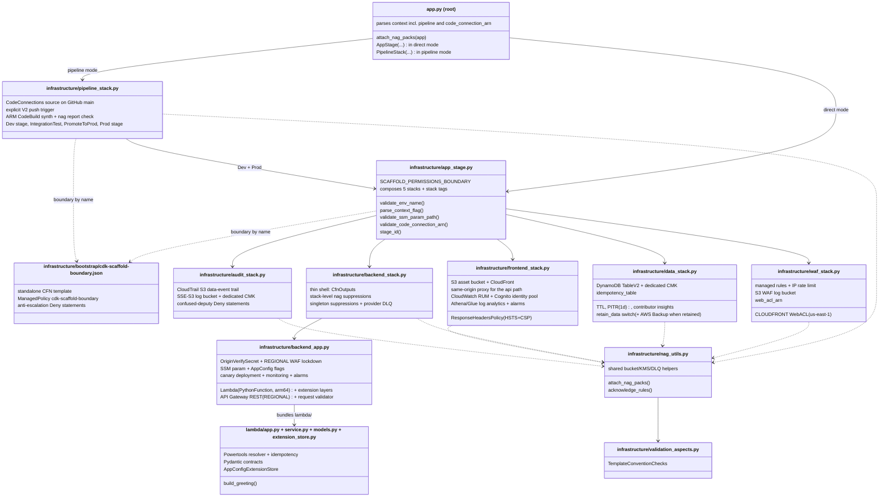

# Components

Major components, their responsibilities, and how they relate. File references are repo-relative.

## Component map

## Infrastructure components

### `app.py` (root) — CDK entry point

Reads CDK context (`region`, `env`, `retain_data`, `appconfig_monitor`, `ssm_param_path`, `pipeline`, `code_connection_arn`), attaches the five cdk-nag packs once at the App root, then branches on `pipeline`. By default it instantiates one `AppStage` (construct id from `stage_id(env, region)`). With `-c pipeline=true` it instead instantiates `PipelineStack("ServerlessAppPipeline")` — after requiring `CDK_DEFAULT_ACCOUNT`, rejecting any `-c env`, and resolving the connection ARN from the context key or the `CODE_CONNECTION_ARN` env var. Context flags are parsed strictly — junk values fail synth rather than silently coercing to `False`.

### `infrastructure/app_stage.py` — AppStage

Groups the five stacks as one deploy unit. Owns environment naming (prod keeps legacy names byte-for-byte; other envs get namespaced, collision-free names, max 39 chars validated at synth), stack tags (`service` / `environment` / `owner`), and the string-computed WAF log S3 locations handed to the frontend's Glue tables. Also owns the synth-time validators `app.py` imports (`parse_context_flag`, `validate_ssm_param_path`, `validate_code_connection_arn` — the latter accepts both the `codeconnections` and the pre-rename `codestar-connections` ARN service names), the permissions-boundary constants (`BOUNDARY_POLICY_NAME`, and `SCAFFOLD_PERMISSIONS_BOUNDARY` — the one descriptor both `AppStage` and `PipelineStack` pass to `super().__init__`, so the wiring cannot drift), and the cross-stack wiring: table → backend; `api_id` + `origin_verify_secret` + `alarm_topic` → frontend; the CloudFront WebACL name (`{waf_stack_name}-cf`) → backend as a plain string.

### `infrastructure/waf_stack.py` — WafStack

CloudFront-scoped WebACL, always us-east-1. Four AWS managed rule groups (shared with the REGIONAL ACL via `build_managed_threat_rules`) plus a 200-requests-per-5-minutes IP rate limit (`RateLimitPerIP`). The ACL carries an explicit name (`{stack_name}-cf`) that the backend's BlockedRequests alarm and the Athena log path both depend on. WAF logs to S3 via `create_waf_logs_bucket` (bucket-policy ordering is load-bearing — see architecture.md) with the shared header redaction and ALLOW-drop filter. Exposes `web_acl_arn`.

### `infrastructure/data_stack.py` — DataStack (stateful)

DynamoDB idempotency table (`TableV2`, on-demand, TTL on `expiration`, PITR with 1-day window, throttled-keys contributor insights) encrypted by its own CMK. `retain_data=True` flips table + CMK to `RETAIN`, enables deletion protection and stack termination protection, and adds an `IdempotencyBackupVault` + `IdempotencyBackupPlan` (daily backups kept 35 days; monthly backups moved to cold storage and kept a year). The `DynamoDBInBackupPlan` acknowledgments apply only in the default PITR-only shape.

### `infrastructure/backend_stack.py` — BackendStack

Thin wrapper per "model with constructs, deploy with stacks": applies compliance aspects, composes `BackendApp`, wires CfnOutputs (direct execute-api URL, function ARN, dashboard URL, alarm topic name...), exposes `api_id` + `origin_verify_secret` for the frontend, applies CDK-singleton suppressions, and attaches the AwsCustomResource provider's async failure DLQ. Stack-level nag acknowledgments live here with per-rule rationales. (The `api_url` attribute still exists but no longer crosses a stack boundary — its temporary export retention was removed after the same-origin migration.)

### `infrastructure/appconfig_extension.py` — AppConfig extension layer pins

- `APPCONFIG_EXTENSION_ARM64_LAYER_ARNS`: AWS-published arm64 AppConfig Agent Lambda extension layer ARNs, copied verbatim from the AWS docs — 2.0.22365 for 37 regions (`aws`, `aws-cn`, `aws-us-gov`, `aws-eusc`), `me-central-1`/`me-south-1` at 2.0.18836.
- `partition_for_region(region)`: the one region→partition helper (`cn-*` → `aws-cn`, `us-gov-*` → `aws-us-gov`, `eusc-*` → `aws-eusc`, else `aws`).
- `validate_appconfig_extension_layer_arn(raw)`: override shape check (versioned layer ARN string, four partitions); non-strings get the same friendly `ValueError`. Re-exported by `app_stage.py`, whose `resolve_appconfig_extension_layer_arn` does context → env-var resolution.
- `resolve_extension_layer_arn(region, override)`: override (re-validated, then region and partition must match the stack's) → map → `ValueError` naming the region, `-c appconfig_extension_layer_arn`, `APPCONFIG_EXTENSION_LAYER_ARN`, and the docs URL; a token region also fails loudly. `BackendApp` adds a synth warning when an override is active; `PipelineStack` adds one too (the override is baked into its Synth env).

### `infrastructure/backend_app.py` — BackendApp construct

The domain-level application, largest infrastructure module. Contains:

- **Lambda**: `PythonFunction` (arm64, Python 3.14 bundling image), bundled from `lambda/` with `requirements.txt`, CMK-encrypted env vars, reserved concurrency (100), `retry_attempts=0` (sync-only invocation), explicit log group, `recursive_loop=Terminate`, the Lambda Insights layer, and the AppConfig extension layer (`_attach_appconfig_extension_layer` → `resolve_extension_layer_arn`: the `appconfig_extension_layer_arn` override if given — region must match the stack — else the per-region pinned map `APPCONFIG_EXTENSION_ARM64_LAYER_ARNS`, raising at synth for an unmapped or token region) with `AWS_APPCONFIG_EXTENSION_PREFETCH_LIST` set.
- **API Gateway**: `REGIONAL` REST API with Prod stage throttling (100 rps / 200 burst), access + execution logging, request tracing. `_attach_greeting_resource` wires `GET /greeting` to the `live` alias (not `$LATEST`) behind a gateway `RequestValidator`, and orders the stage after its pre-created execution log group.
- **Configuration**: SSM greeting parameter (name overridable via `ssm_param_path`); AppConfig application/environment/`AWS.Freeform` profile + hosted configuration (from `infrastructure/feature_flags.json`, CMK-encrypted, `deletion_protection_check="BYPASS"` for deterministic teardown) with all-at-once default deployment.
- **`OriginVerifySecret`**: Secrets Manager secret (backend CMK) — the value CloudFront injects as `x-origin-verify` and the regional WAF byte-matches. No rotation Lambda by design; the in-code rotation recipe is two deploys with a temporary `export_value()` retention — never a construct rename, never a new value put into the existing secret.
- **`_attach_canary_deployment`**: publishes a version, shifts the `live` alias via CodeDeploy (`CANARY_10PERCENT_5MINUTES` in prod, `ALL_AT_ONCE` in dev) with alarm-driven rollback.
- **`_attach_appconfig_rollback_monitor`** (only when `appconfig_monitor=True`): gradual flag rollout + environment monitor on a **by-name** `FeatureFlagEvaluationFailure` metric (using `function.metric_errors()` would create a dependency cycle that only `Template.from_stack` catches).
- **`_attach_regional_waf`**: REGIONAL WebACL (`{stack_name}-api`) — the four shared managed groups (priorities 0-3) plus `RejectNonCloudFront` (priority 4: block unless `x-origin-verify` exactly matches the secret; supersedes the earlier `RateLimitDirectCallers` rule) — with its own S3 log bucket (shared redaction + ALLOW-drop filter), associated with the Prod stage.
- **`_build_monitoring`**: cdk-monitoring-constructs `MonitoringFacade` dashboard; Lambda p90-latency and error alarms, API Gateway 5xx, DynamoDB read/write throttle alarms, a `GreetingRequests` KPI widget; SNS topic only in prod (`_build_alarm_topic`, whose policy admits CloudWatch alarms and AWS Budgets).
- **`_attach_waf_alarms`**: BlockedRequests spike alarms addressed by WebACL **name** (regional always; CloudFront only when the stack is in us-east-1, where those metrics publish).
- **`_attach_cloudwatch_spend_budget`** (prod only): a monthly `AmazonCloudWatch` cost budget notifying the alarm topic at 80% of actual — the backstop for RUM's uncapped ingestion.
- **`_create_insights_queries`**: saved Logs Insights queries; Application Insights resource group + dashboard-cleanup custom resource.

### `infrastructure/frontend_stack.py` — FrontendStack

S3 asset bucket (CMK, versioned with 30-day noncurrent-version expiry) + access-log bucket (SSE-S3) + CloudFront distribution with the WAF ACL. The `/api/*` behavior (`_build_api_origin_behavior`) is the same-origin API proxy: a JS 2.0 viewer-request CloudFront Function strips the `/api` prefix; the `HttpOrigin` targets `{api_id}.execute-api.{region}.amazonaws.com` with `origin_path="/Prod"` and the `x-origin-verify` custom header (resolved from the secret via a CFN dynamic reference); caching is disabled and forwarding is all-viewer-except-host. Also: a custom `ResponseHeadersPolicy` (HSTS without `preload`; CSP `connect-src 'self'` plus only the RUM data plane and Cognito Identity — no execute-api entry, since the API is same-origin), `BucketDeployment` of `frontend/` plus a generated `config.json` (`apiUrl: "/api"` + RUM config), CloudWatch RUM app monitor (pinned name, Cognito identity pool, X-Ray client correlation) with a log-group cleanup custom resource, the Athena/Glue analytics layer (`_create_athena_glue_resources`: partition-projected tables for CloudFront access logs + both WAF log locations, named triage queries, CMK-encrypted Athena workgroup), and `_attach_analytics_alarms` (Athena failed-query and RUM session-spike alarms, routed to the backend's alarm topic in prod).

### `infrastructure/audit_stack.py` — AuditStack (stateful)

CloudTrail trail scoped to object-level S3 data events on the frontend buckets (`include_management_events=False` — the CDK default would bill a second copy of every management event). Pinned trail name enables the confused-deputy Deny statements (two separate ones so IAM ORs the condition keys) and the CMK's scoped CloudTrail grant. Same `retain_data` semantics as DataStack, plus the compliance tier on the log bucket (versioning, Object Lock GOVERNANCE with 1-year default retention, Glacier@90d / Deep Archive@365d, 7-year expiry). Object Lock is creation-time-only, so flipping `retain_data` on an already-deployed stack **replaces** `CloudTrailLogsBucket`.

### `infrastructure/pipeline_stack.py` — PipelineStack (pipeline mode only)

Synthesized only with `-c pipeline=true`. Module constants: `GITHUB_REPO` (this repo's slug), `GITHUB_BRANCH = "main"`, `DEV_ENV_NAME = "dev"` (pipeline-reserved), and `UV_VERSION`. Builds its own CMK (`PipelineKey`), a CFN-owned build log group, a KMS artifact bucket (90-day expiry), the underlying V2 pipeline (`restart_execution_on_update=True`), and a `CodeBuildStep` Synth (`npm ci`, `pip install uv==UV_VERSION` (`0.12.24`, pinned in step with CI's setup-uv `version:` and pyproject's `required-version`), `npx cdk synth -c pipeline=true '**'`, then `check_validation_report.py`; `CODE_CONNECTION_ARN` in its env) on ARM CodeBuild with Docker enabled. `_add_stages` adds `Dev` with the `IntegrationTest` post-step (`make install-lambda` + `make test-integration`, dev stack names exported, DescribeStacks scoped to the two dev stacks) and `Prod` behind `ManualApprovalStep("PromoteToProd")`. `__init__` forces `build_pipeline()` so that `_declare_push_trigger` (the `Triggers` property override) and `_acknowledge_pipeline_findings` (IAM5 / inline-policy / CodeBuild source-URL acknowledgments, each `<AWS::Partition>` id paired with its literal-`aws` sibling by `_with_literal_partition`) see the final construct tree.

### `infrastructure/bootstrap/cdk-scaffold-boundary.json` — permissions boundary

A standalone CloudFormation template (plain JSON, deployed by `make bootstrap-boundary` as stack `CdkScaffoldBoundary`) that creates the `cdk-scaffold-boundary` managed policy: `AllowServiceActions` (service-wide allows for the services the app and pipeline use) plus Deny statements against tampering with the boundary policy, removing or replacing boundaries, creating roles/users without it, and attaching or inlining policies onto unbounded principals. Pinned by `tests/cdk/test_bootstrap_boundary.py`; README "CI/CD pipeline" names the residual paths a boundary cannot close. `--custom-permissions-boundary` on `cdk bootstrap` bounds only the `CloudFormationExecutionRole`.

### `infrastructure/nag_utils.py` — shared helpers

The compliance and shared-pattern toolbox: `attach_nag_packs`, `apply_compliance_aspects`, `acknowledge_rules` (v2-shaped suppression data → v3 acknowledge API, with a metadata fallback for finding ids CDK's API rejects), confused-deputy KMS grant helpers (`grant_logs_service_to_key`, `grant_cloudtrail_service_to_key`, `grant_cloudwatch_alarms_to_key`, `grant_budgets_to_key`), `route_operational_alarm` (prod: SNS action; non-prod: scoped CloudWatchAlarmAction acknowledgments), `build_managed_threat_rules` (the shared WAF rule list), `waf_log_redacted_fields` + `WAF_LOG_DROP_ALLOW_FILTER`, `attach_async_failure_destination` (SQS DLQ for async-invoked provider Lambdas), `suppress_cdk_singletons` + `CDK_LAMBDA_SUPPRESSIONS`, `create_auto_delete_objects_log_group`, `create_sse_s3_log_bucket` (with opt-in `versioned=` / `object_lock_default_retention=` / `transitions=` for the audit compliance tier) + the public `LOG_SINK_SUPPRESSION_RULES` (reused by the pipeline's artifact bucket), `waf_logs_bucket_name` / `create_waf_logs_bucket`. Also exports the CDK singleton construct ids (`AWS_CUSTOM_RESOURCE_PROVIDER_ID`, `BUCKET_DEPLOYMENT_PROVIDER_ID`).

### `infrastructure/validation_aspects.py` — TemplateConventionChecks

Per-stack Aspect enforcing two project conventions no rule pack covers: every log group declares explicit retention, and every stateful L1 (`CfnBucket`, `CfnTable`, `CfnGlobalTable`, `CfnKey`) declares an explicit removal policy. Violations are error-level annotations that fail synth.

## Lambda components

| Module | Responsibility |
|---|---|
| `lambda/app.py` | Handler layer: Powertools resolver (validation; no `CORSConfig` — the API is same-origin), shared botocore retry config for the SSM and DynamoDB clients (`adaptive`, `total_max_attempts=2`, 0.5s/1s timeouts — sized so the idempotency layer's two serial DynamoDB writes stay under the 10s function timeout; budget math documented inline), idempotency layer keyed on the `Idempotency-Key` header (lowercased before JMESPath), `AppConfigExtensionStore` + `FeatureFlags` construction, tenant-id resolution for observability, translation of idempotency errors to hand-built 400/409 responses (no CORS headers needed) |
| `lambda/service.py` | `build_greeting`: SSM read (300s cache) → `enhanced_greeting` flag evaluation (graceful fallback + `FeatureFlagEvaluationFailure` EMF metric — the only signal a broken flag config is live) → message composition. Domain error `GreetingUnavailableError` keeps the layer HTTP-free |
| `lambda/models.py` | Pydantic contracts: `EnvVars` (import-time env validation), `GreetingResponse`, and the 400/409/500 response models that exist to document the OpenAPI contract |
| `lambda/extension_store.py` | `AppConfigExtensionStore` (a Powertools `StoreProvider`, replacing the SDK-backed `AppConfigStore`): reads the flag document from the extension at `http://localhost:2772/applications/{app}/environments/{env}/configurations/{profile}` (2s timeout) behind a monotonic-clock TTL cache (`max_age`, default 300). Any failure — `OSError`, `ValueError`, `http.client.HTTPException`, or a non-object document — raises `ConfigurationStoreError`, which the service layer already degrades to default flag values + the failure metric. Deliberately no stale-serve or backoff |
| `lambda/requirements.txt` | Exported from `uv.lock`'s lambda group (`make lock`); bundled into the deployed function; CI gates drift |

## Test components

| Suite | Venv | Scope |
|---|---|---|
| `tests/unit/` | `.venv-lambda` | Handler behavior with mocked AWS (autouse fixture patches `ssm_provider.get` + `feature_flags.evaluate`); `AppConfigExtensionStore` behavior (`test_extension_store.py`: endpoint fetch, TTL cache and expiry, HTTP/protocol errors, malformed or non-object JSON); 100% branch-coverage gate on `lambda/`; EMF dimension-set contract test; feature-flag schema test |
| `tests/cdk/` | `.venv` | Stack assertions (`test_stacks.py`); Stage contracts, the in-process nag gate over every shipped shape, boundary-on-every-role, connection-ARN validation, and per-region extension-layer resolution (`TestAppConfigExtensionLayerRegion`: mapped `ap-southeast-2`, unmapped `us-iso-east-1` → `ValueError`, override + region-mismatch; `TestAppConfigExtensionLayerOverrideResolution`: context > env var > map, validator) (`test_stage.py`); pipeline structure, push trigger, ARM fleet, stage ladder, and nag gate (`test_pipeline_stack.py`); boundary-template invariants (`test_bootstrap_boundary.py`); Aspect unit tests (`test_validation_aspects.py`); template snapshots (`test_snapshots.py` + `snapshots/*.json`, including `ServerlessAppPipeline.json`; regenerate with `UPDATE_SNAPSHOTS=1 make test-cdk`) |
| `tests/integration/` | `.venv-lambda` | Live tests against a deployed stack: the API through CloudFront's `/api/greeting`, `test_direct_execute_api_is_blocked` (direct execute-api URL → 403), frontend delivery and `config.json` (`apiUrl == "/api"`). Excluded from GitHub Actions CI (no credentials) but run by the pipeline's `IntegrationTest` step against `dev`; stack names come from `AWS_BACKEND_STACK_NAME` / `AWS_FRONTEND_STACK_NAME` (`D:`-prefixed pytest-env defaults, so exported values win) |
| `tests/conftest.py` | shared | Loads `lambda/app.py` by absolute file path (the root CDK `app.py` would shadow it) and appends `lambda/` to `sys.path` for its flat sibling imports |

## Automation components

| Component | Role |
|---|---|
| `Makefile` | Canonical interface; `make help` self-documents. Notable: two-venv selector via `UV_PROJECT_ENVIRONMENT`, `'**'` glob on every Stage-scoped CDK command, guarded `deploy-appconfig-monitor`, `destroy-clean` log-group snapshot/sweep machinery (merge-based, resume-safe snapshot; up to three 60s-spaced retries on log stragglers), and the CD / account-operations targets `bootstrap-boundary`, `deploy-pipeline`, `destroy-pipeline`, `audit-account`, `hibernate-dns`, `wake-dns` |
| `scripts/audit_account.sh` | `make audit-account`: read-only scan of every enabled region for CloudFormation stacks, log groups, CodeDeploy apps, Cognito user pools, and Cognito identity pools (the app's own `RumIdentityPool`, `<FrontendStackName>-rum`) matching the app's name patterns, plus global S3 buckets; exits 0 clean / 1 dirty / 2 no credentials. Prints but does not count Route 53 zones, domain registrations (with auto-renew flags), and ACM certificates; lists the expected survivors (`CDKToolkit`, `CdkScaffoldBoundary`, CodeConnections connections) and Cost Explorer month-to-date by service |
| `scripts/dns_lifecycle.sh` | `make hibernate-dns` / `make wake-dns`: requires `DOMAIN_NAME` in `./.env` (exit 2 otherwise). Hibernate refuses while any us-east-1 `ServerlessApp*` stack is in a deployed `*_COMPLETE` state, deletes every record except the apex NS/SOA, then the zone. Wake idempotently adopts or creates the zone, re-points the Route 53 Domains registration's name servers, and rewrites `HOSTED_ZONE_ID` in `./.env`; deploy only after NS propagation settles, or ACM DNS validation stays pending |
| `.github/workflows/ci.yml` | Three-job core (quality / test / cdk-check) + PR-only `cdk-diff` sticky comment; ARM runners for native Lambda bundling |
| Other workflows | `codeql.yml` (Python analysis with security-extended queries; push/PR/weekly), `scorecard.yml` (OpenSSF Scorecard → code scanning; weekly + push + manual `workflow_dispatch`; `repo_token` uses an optional `SCORECARD_TOKEN` secret, falling back to `github.token`), `dependency-audit.yml` (weekly pip-audit over each of the five dependency groups exported separately, plus `npm audit` on the pinned node tooling — independent lanes so one ecosystem's failure can't hide the other's), `dependabot-auto-merge.yml` (auto-approves + squash-auto-merges **patch/minor** bumps across all three ecosystems — GitHub Actions, uv/pip, npm; majors stay manual), `pr-title.yml` (Conventional Commit regex gate on PR titles), `docs.yml` (Zensical build + coverage badge → GitHub Pages, on push to main), `release.yml` (publishes the GitHub Release from the annotated `v*` tag; no-op if already published) |
| `.pre-commit-config.yaml` | ruff format → ruff lint → mypy (serial; excludes `lambda/`+`scripts/` — checked in `.venv-lambda` instead) → bandit → pylint → hygiene hooks → xenon complexity → pip-audit. Tools run from the venv (`language: system`) so versions come from `pyproject.toml`. `check-added-large-files` excludes `^tests/cdk/snapshots/` (the pipeline snapshot legitimately exceeds the hook's default ceiling) |
| `frontend/index.html` | Static page: RUM web client snippet (config from the deploy-generated `/config.json`) + a fetch against `${apiUrl}/greeting` (= `/api/greeting`) with a fresh `Idempotency-Key` |
