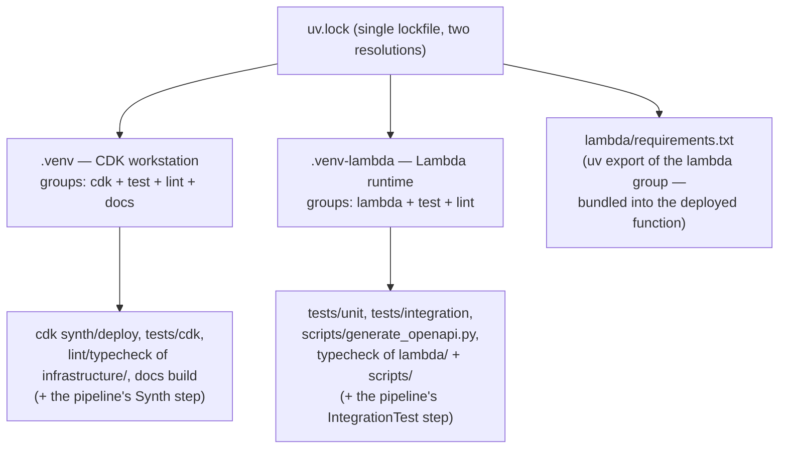
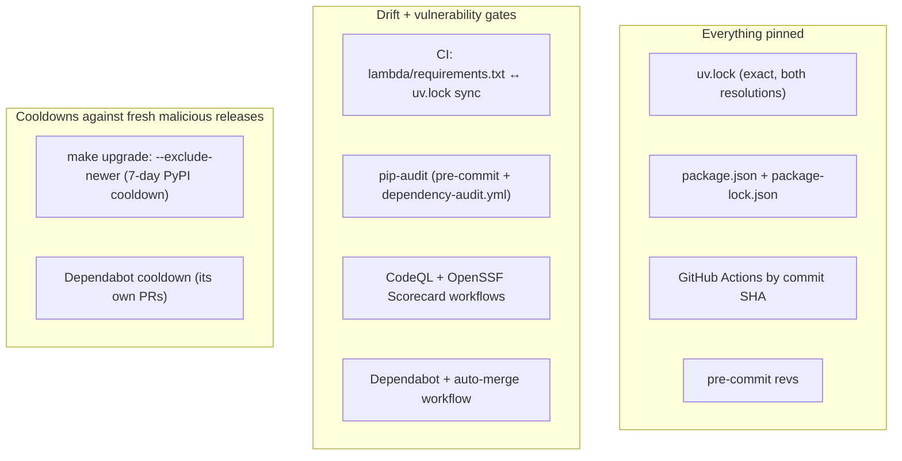

# Dependencies

External dependencies, how they're partitioned, and the supply-chain posture around them.

## The two-venv model (the central constraint)

CDK and Powertools require incompatible `attrs` versions (CDK pulls `attrs<26` via jsii; Powertools pulls `attrs>=26`). `[tool.uv.conflicts]` in `pyproject.toml` declares the `lambda` and `cdk` dependency groups mutually exclusive, so **one `uv.lock` holds both resolutions**, installed into separate venvs:

- Never install Powertools into `.venv` or CDK into `.venv-lambda`.
- One deliberate exception: plain `pydantic` is pinned in the `lint` group so the `pydantic.mypy` plugin loads in **both** venvs (it has no `attrs` dependency).
- The venv selector is `UV_PROJECT_ENVIRONMENT` (used by the Makefile); installs use `uv sync --locked` so a stale lock fails loudly.
- Inside the CD pipeline the same split holds: the Synth step reaches the CDK side through `cdk.json`'s app command (`uv run --group cdk --group test python3 app.py`), and the `IntegrationTest` step runs `make install-lambda` before `make test-integration`.

## Dependency groups (PEP 735, `pyproject.toml`)

| Group | Contents | Where it lands |
|---|---|---|
| `lambda` | `aws-lambda-powertools[all]`, `aws-xray-sdk`, `boto3` | `.venv-lambda` + the deployed bundle (via `lambda/requirements.txt`) |
| `cdk` | `aws-cdk-lib`, `constructs`, `aws-cdk-aws-lambda-python-alpha`, `cdk-monitoring-constructs`, `cdk-nag` | `.venv` |
| `test` | pytest + plugins (env, cov, xdist, mock, html, timeout, randomly), `requests` | both venvs |
| `lint` | ruff, mypy, pylint, bandit, xenon, radon, pip-audit, pre-commit, boto3-stubs, pydantic | both venvs |
| `docs` | zensical, mkdocstrings(-python) | `.venv` only |

All versions are exact-pinned (`==`). The group structure is unchanged since the first KB generation (2026-07-06); only versions moved (for example `aws-lambda-powertools` 3.29.0 → 3.31.0).

## Key runtime/infrastructure dependencies and their roles

| Dependency | Role |
|---|---|
| `aws-lambda-powertools[all]` | Logger, Tracer, Metrics (EMF), APIGatewayRestResolver + validation, Idempotency, SSMProvider, FeatureFlags + the `StoreProvider` interface that `AppConfigExtensionStore` implements (the SDK-backed `AppConfigStore` is no longer used), event data classes |
| `aws-cdk-lib` / `constructs` | All infrastructure, including the `pipelines` module behind `PipelineStack`; feature flags curated in `cdk.json` (safe / template-changing / IAM groups, with two documented skips) |
| `aws-cdk-aws-lambda-python-alpha` | `PythonFunction` — bundles `lambda/` with `requirements.txt` in a container (arm64, needs Docker locally / ARM runners in CI / the ARM CodeBuild fleet in the pipeline) |
| `cdk-nag` | The five policy-validation rule packs (v3 plugin engine) |
| `cdk-monitoring-constructs` | `MonitoringFacade` dashboard + latency/error/throttle alarms |
| `boto3` / `botocore` | AWS SDK; the handler pins an explicit retry `Config` (adaptive mode, `total_max_attempts=2`, 0.5s/1s timeouts) shared by the SSM and DynamoDB clients — feature-flag reads no longer go through an SDK client |
| AppConfig Lambda extension layer (ARM64) | AWS-published layer, pinned by ARN per region in `APPCONFIG_EXTENSION_ARM64_LAYER_ARNS` (`appconfig_extension.py`; 39 regions). Outside `uv.lock` and Dependabot — update by hand from the AppConfig user guide's version table |
| Lambda Insights layer | `LambdaInsightsVersion.VERSION_1_0_498_0` (resolved by CDK); writes to the account-shared `/aws/lambda-insights` log group, which the stack deliberately does not own |

## Node-side tooling (`package.json`)

`aws-cdk` (the CLI) and `markdownlint-cli` are pinned as devDependencies, installed by `npm ci`, and invoked via `npx` — never globally installed. This makes the CLI a locked, Dependabot-tracked supply-chain input like every Python dependency.

## Pre-commit tooling strategy

Every linter with a `pyproject.toml` pin runs as a `language: system` hook so its version comes from the project venv — Dependabot's pre-commit ecosystem bumps `rev:` fields but never `additional_dependencies`, so tools pinned in both places would drift silently. Only the zero-config hygiene hooks (`pre-commit-hooks`) use a remote `rev:`. mypy runs `require_serial: true` (its SQLite cache lock-contends across parallel workers on 2-CPU CI runners) and excludes `lambda/`+`scripts/` (checked properly in `.venv-lambda` via `make typecheck` instead — Powertools isn't importable in `.venv`).

## Supply-chain hygiene

- pip-audit's `--ignore-vuln` list lives **only** in `.pre-commit-config.yaml` (mirrored in `dependency-audit.yml`); `make security` routes through the hook so the suppression list never forks. Current ignores are dated with re-check notes.
- The cooldown applies to `make upgrade` only, not `make lock` — `lock` reproduces already-made decisions; `upgrade` is where new versions enter.
- `npm update` and `pre-commit autoupdate` (both run by `make upgrade`) do **not** honor the PyPI cooldown; review their diffs by release date.
- **uv is pinned to `0.12.24`** across three kinds of location that must move together by hand: the `version:` input on every `astral-sh/setup-uv` step (`ci.yml` ×4, `dependency-audit.yml`, `docs.yml`), the `UV_VERSION` constant in `infrastructure/pipeline_stack.py` (both CodeBuild steps run `pip install uv==UV_VERSION`; the pipeline snapshot changes with it), and the `required-version = ">=0.12.24"` floor in `[tool.uv]` (a floor, so a newer local uv still works). Dependabot does **not** cover these: its `github-actions` ecosystem bumps the setup-uv action SHA, not the action's `version:` input, and its `uv` ecosystem updates packages in `pyproject.toml`/`uv.lock`, not the uv binary or `required-version` (`.github/dependabot.yml` has no entry that would).
- **Residual unpinned inputs** (the exceptions to "everything pinned"): the AWS-published Lambda layers are pinned by ARN/version but invisible to Dependabot; the pipeline's CodeBuild managed image (`AMAZON_LINUX_2023_STANDARD_3_0`) is AWS-maintained.

## Version-sensitive facts (verify when bumping)

- **cdk-nag 3.x** switched from Aspects to policy-validation plugins — the entire gating architecture (`attach_nag_packs`, report parsing, `check_validation_report.py`) is built around v3 behavior, including the fact that Python-app synth does not fail natively on findings (verified against aws-cdk-lib 2.261.0 + cdk-nag 3.0.1; drop the script if CDK ever fails jsii-app synth natively).
- **`acknowledge_rules`' metadata fallback** for finding ids containing multiple `::` exists for a CDK acknowledge-API limitation — drop when fixed upstream.
- **Zensical is pre-1.0** — docs-group versions are pinned exactly and can break on minor bumps.
- The Lambda bundling image tracks the runtime (`Runtime.PYTHON_3_14`, arm64); CI's `cdk-check`/`cdk-diff` jobs run on ARM runners and the pipeline's CodeBuild fleet is ARM specifically so bundling runs natively (an x86 CodeBuild host fails with `exec format error`; CodeBuild has no QEMU binfmt).
- **CDK Pipelines internals**: `_declare_push_trigger` is a CFN escape hatch on the pipeline's `node.default_child` and raises `TypeError` if that stops being a `CfnPipeline`; the pipeline's IAM5 acknowledgments embed construct-tree logical-id hashes. Re-run `make test-cdk` (pipeline nag gate + snapshot) on every `aws-cdk-lib` bump.
- **AppConfig extension layer**: pinned at extension **2.0.22365** (launched 2026-08-24; us-east-1 = layer version 265) for the 37 regions in AWS's current arm64 table across `aws`/`aws-cn`/`aws-us-gov`/`aws-eusc`; `me-central-1`/`me-south-1` stay at 2.0.18836 (absent from the 2.0.20159+ tables). Refresh verbatim from https://docs.aws.amazon.com/appconfig/latest/userguide/appconfig-integration-lambda-extensions-versions.html; check freshness via the public SSM parameter `/aws/service/aws-appconfig/lambda-extension/arm64/latest`. Override per deploy with `-c appconfig_extension_layer_arn` / `APPCONFIG_EXTENSION_LAYER_ARN`.
- **pytest-env `D:` prefix** (pytest-env 1.6.0): marks the stack-name variables as defaults that an exported value overrides — without it pytest-env silently clobbers the override back to the prod names.
