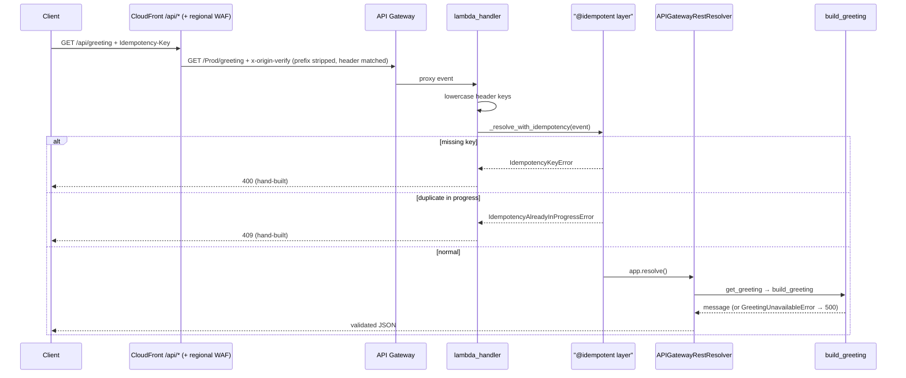

# Interfaces and Integration Points

Every boundary where components talk to each other or to the outside world.

## HTTP API

One route, defined in `lambda/app.py` and documented by the **committed** `docs/openapi.json` (regenerated by `make openapi`; CI fails on drift and on breaking changes via oasdiff).

| Aspect | Value |
|---|---|
| Route | `GET /greeting` (API Gateway REST `REGIONAL`, Prod stage, proxied to the Lambda `live` alias). Browsers call it same-origin as `/api/greeting` through CloudFront; the direct `execute-api` URL answers a flat 403 at the regional WAF |
| Required header | `Idempotency-Key` — missing → 400; duplicate while original in-flight → 409 |
| Responses | 200 `GreetingResponse`, 400 `MissingIdempotencyKeyResponse`, 409 `IdempotencyInProgressResponse`, 500 `InternalErrorResponse` |
| CORS / origin | No CORS at all — same-origin through CloudFront `/api/*` (no `CORSConfig`; the hand-built 400/409 carry only `Content-Type`). Origin lockdown instead: CloudFront injects `x-origin-verify`, and the regional WAF's `RejectNonCloudFront` rule blocks any request whose header value is not an exact match for `OriginVerifySecret` |
| Validation | Gateway `RequestValidator` (body + parameters) on the method, then Powertools `enable_validation=True` — Pydantic on request/response; same models drive the OpenAPI schema |
| Spec exposure | Build-time only (`scripts/generate_openapi.py`); deliberately **not** served at runtime (`enable_swagger` is not called) |

Caching caveat: `@idempotent` wraps the whole resolver, so non-2xx resolver *returns* (404/422/500) are cached under the client's key for 1 hour; only raised exceptions are not cached. Documented in `_resolve_with_idempotency`'s docstring with the fork path (`@idempotent_function` on the service layer).

## Cross-stack interfaces (CDK)

| Producer | Consumer | Interface |
|---|---|---|
| DataStack | BackendStack | `idempotency_table` (ITableV2) → Lambda env var `IDEMPOTENCY_TABLE_NAME` + scoped read/write grant. The single data↔compute relationship |
| WafStack | FrontendStack | `web_acl_arn` — SSM-bridged automatically when regions differ (`cross_region_references=True`) |
| BackendStack | FrontendStack | `api_id` (builds the `/api/*` origin domain `{api_id}.execute-api.{region}.amazonaws.com`), `origin_verify_secret` (injected as the `x-origin-verify` origin header via a CFN dynamic reference), and `alarm_topic` (prod only, `None` elsewhere — routes the frontend's Athena/RUM alarms). The former `api_url` export is gone |
| FrontendStack | AuditStack | `audited_buckets` (asset + access-log buckets) — one-way, audit → frontend |
| AppStage | FrontendStack | WAF log S3 locations as computed strings (account pseudo-param only; avoids cross-region references) |
| AppStage | BackendStack | `cf_web_acl_name` — the CloudFront WebACL's name (`{waf_stack_name}-cf`) as a plain string, used as the `WebACL` dimension of the CloudFront BlockedRequests alarm; no construct reference |
| PipelineStack | AppStage (×2) | `Dev`: `env_name="dev"`, `retain_data=False`, `ssm_param_path=None`, `appconfig_monitor` forwarded. `Prod`: default (legacy) naming with `retain_data` / `appconfig_monitor` / `ssm_param_path` forwarded from context |
| AppStage, PipelineStack | IAM | `permissions_boundary=SCAFFOLD_PERMISSIONS_BOUNDARY` — references the `cdk-scaffold-boundary` managed policy **by name**; the policy itself is deployed out-of-band by `make bootstrap-boundary` |

## Configuration interfaces

### CDK context keys (set via `-c key=value`, `cdk.json`, or `ENVIRONMENT` env var)

| Key | Default | Effect |
|---|---|---|
| `region` | `us-east-1` | Target region for data/backend/frontend/audit (WAF pinned to us-east-1). Any region in the pinned AppConfig extension layer map in `appconfig_extension.py` (every region in AWS's arm64 table) synthesizes; an unmapped region raises a `ValueError` at synth unless `appconfig_extension_layer_arn` is set (pinned by `tests/cdk/test_stage.py::TestAppConfigExtensionLayerRegion`) |
| `env` | `prod` (or `ENVIRONMENT` var) | Deployment environment; non-prod namespaces stack names and disables alarm paging. `dev` is pipeline-reserved; any `env` value is rejected in pipeline mode |
| `retain_data` | `false` | `true` flips data + audit stacks to RETAIN + deletion/termination protection (and adds Backup + the audit compliance tier). Safe from the first deploy; sticky home is `cdk.json`. In pipeline mode it applies to prod only (dev is pinned `false`) |
| `appconfig_monitor` | `false` | `true` enables gradual AppConfig rollout + alarm rollback monitor. **Never on a cold deploy** (in pipeline mode: not until both dev and prod have reported the metric) |
| `ssm_param_path` | unset (`None`) | Overrides the greeting SSM parameter's auto-generated name (e.g. `/org/app/greeting`; validated by `validate_ssm_param_path`). Set before the first deploy — changing it replaces the parameter and resets its value. Not forwarded to the pipeline's dev stage |
| `pipeline` | `false` | `true` synthesizes `PipelineStack` instead of a direct `AppStage`. Requires `CDK_DEFAULT_ACCOUNT` and a connection ARN; never set in `cdk.json` (documented there only in a comment) |
| `code_connection_arn` | none (required in pipeline mode) | CodeConnections ARN, falling back to the `CODE_CONNECTION_ARN` env var; validated by `validate_code_connection_arn` (`codeconnections` or legacy `codestar-connections`). Deliberately never stored in `cdk.json` |
| `appconfig_extension_layer_arn` | unset (`None`) | Overrides the pinned per-region AppConfig extension layer ARN, falling back to the `APPCONFIG_EXTENSION_LAYER_ARN` env var; validated by `validate_appconfig_extension_layer_arn` (versioned layer ARN, partition `aws`/`aws-cn`/`aws-us-gov`/`aws-eusc`) and its region and partition must match the deploy region. An active override emits a synth warning. Forwarded to both pipeline stages and baked into the Synth step env when set — sticky until unset + `make deploy-pipeline` |

Boolean context values are strictly parsed (`parse_context_flag`) — anything but `true`/`false` fails synth. `cdk.json` itself sets only `retain_data: false` among these keys.

### Workstation environment and `./.env`

| Name | Where it is read | Notes |
|---|---|---|
| `CODE_CONNECTION_ARN` | `app.py` (fallback for `code_connection_arn`); `make deploy-pipeline` / `destroy-pipeline` (from `./.env`) | The pipeline's Synth CodeBuild env carries it after the birth deploy |
| `CONN=<arn>` (make variable) | `make deploy-pipeline` / `destroy-pipeline` | Highest-priority source for the connection ARN |
| `CDK_DEFAULT_ACCOUNT` | `app.py`, pipeline mode only | Set by the CDK CLI from the active credentials; synth fails without it |
| `ENVIRONMENT` | `app.py` | Fallback for the `env` context key |
| `APPCONFIG_EXTENSION_LAYER_ARN` | `app.py` (fallback for `appconfig_extension_layer_arn`) | Empty = unset; the pipeline's Synth CodeBuild env carries it when the birth deploy set an override |
| `DOMAIN_NAME` | `scripts/dns_lifecycle.sh` (from `./.env`) | Required by `hibernate-dns` / `wake-dns` |
| `HOSTED_ZONE_ID` | written by `make wake-dns` into `./.env` | Not yet consumed by `app.py` — the README "Custom domain" design routes `DOMAIN_NAME` / `HOSTED_ZONE_ID` through `deploy-pipeline` into the app, but that is unimplemented |
| `AWS_BACKEND_STACK_NAME`, `AWS_FRONTEND_STACK_NAME` | `tests/integration/` | `D:`-prefixed pytest-env defaults point at the prod stack names; an exported value wins (the pipeline's integration step exports the dev names) |
| `ENV=`, `REGION=` (make variables) | env-aware Make targets | `ENV` empty = prod legacy names; `REGION` defaults to `us-east-1` |

`./.env` is gitignored, optional, and sourced only for the duration of the command that reads it — nothing exports it into the shell.

### Lambda environment variables (validated by `EnvVars` at import)

`IDEMPOTENCY_TABLE_NAME`, `GREETING_PARAM_NAME`, `APPCONFIG_APP_NAME`, `APPCONFIG_ENV_NAME`, `APPCONFIG_PROFILE_NAME`, `POWERTOOLS_SERVICE_NAME`, `POWERTOOLS_METRICS_NAMESPACE`, optional `APPCONFIG_MAX_AGE_SECONDS` (default 300). CDK also sets `POWERTOOLS_LOG_LEVEL` and `AWS_APPCONFIG_EXTENSION_PREFETCH_LIST` (the extension's cold-start prefetch path); neither is validated by `EnvVars`.

### Feature flags

`infrastructure/feature_flags.json` → AppConfig hosted configuration (`AWS.Freeform` profile, deployed by CloudFormation) → served by the AppConfig Lambda extension on `localhost:2772` → read through `AppConfigExtensionStore` → evaluated per request as `enhanced_greeting` with `{source_ip, user_agent}` context. Schema pinned by `tests/unit/test_feature_flags_schema.py`.

## Developer interface (Makefile)

`make help` is self-documenting. The load-bearing targets:

| Target | Purpose |
|---|---|
| `make install` / `make doctor` | Provision both venvs + npm tooling + pre-commit; verify the setup |
| `make pr` | Every CI gate locally, in CI's order (lock check, lint, typecheck, docs lint, unit tests, CDK tests, synth + nag gate, OpenAPI drift) |
| `make test` / `test-cdk` / `test-integration` | Unit (`.venv-lambda`, 100% gate) / CDK assertions (`.venv`) / live integration |
| `make cdk-synth` | `cdk synth '**'` + `scripts/check_validation_report.py` (the real nag gate) |
| `make deploy [ENV=name]` / `deploy-appconfig-monitor` / `destroy-clean [ENV=name]` | Deploy, guarded second-deploy monitor enablement, teardown with async-log sweeps (merge-based snapshot, up to three retries on log stragglers) |
| `make bootstrap-boundary` | Deploy/update the `cdk-scaffold-boundary` policy stack (`CdkScaffoldBoundary`) — before `cdk bootstrap --custom-permissions-boundary cdk-scaffold-boundary` and before any deploy |
| `make deploy-pipeline [CONN=arn]` | One-time birth deploy of `ServerlessAppPipeline` (it self-mutates afterwards). Connection ARN: `CONN=` → `CODE_CONNECTION_ARN` in `./.env` → auto-discovery of exactly one AVAILABLE GitHub connection (fails loudly on zero or several) |
| `make destroy-pipeline` | `cdk destroy ServerlessAppPipeline --force` (a dummy, valid-shaped ARN is the fallback, so teardown works after the connection is gone), then two sweeps of re-created `ServerlessAppPipeline` log groups 60s apart |
| `make audit-account` | Read-only post-teardown gate (`scripts/audit_account.sh`): exit 0 clean / 1 dirty / 2 no credentials |
| `make hibernate-dns` / `wake-dns` | Park / resume the Route 53 hosted zone for the planned custom domain (`scripts/dns_lifecycle.sh`) |
| `make openapi` / `compare-openapi` | Regenerate / drift-check the committed spec |
| `make lock` / `upgrade` / `deps-merge` | Lockfile regeneration (incl. `lambda/requirements.txt` export), cooldown-gated upgrades, Dependabot PR processing |
| `make coverage` / `coverage-badge` | Combined cross-venv coverage report / shields endpoint JSON |

All Stage-scoped CDK commands use the `'**'` glob — bare `cdk synth`/`deploy`/`diff` sees only the empty Stage manifest. The pipeline targets instead name the top-level `ServerlessAppPipeline` stack directly (with `-c pipeline=true`).

## CI interfaces (GitHub Actions)

| Job / workflow | Gate |
|---|---|
| `quality` | requirements.txt↔uv.lock sync, pre-commit hooks, markdownlint |
| `test` | unit tests (100% coverage), OpenAPI drift, oasdiff breaking-change gate (PRs) |
| `cdk-check` | `cdk synth '**'` (real asset bundling, ARM runner), validation-report check, CDK assertion suite |
| `cdk-diff` (PRs) | Synthesizes base + PR, posts a sticky CloudFormation-diff comment (`scripts/cdk_pr_diff.py`), credential-free |
| `pr-title.yml` | Conventional Commit grammar on PR titles (squash-merge subjects feed git-cliff) |
| `release.yml` | Publishes the GitHub Release when a `vX.Y.Z` tag is pushed |
| `docs.yml` | Builds Zensical site + coverage badge JSON to GitHub Pages |
| `scorecard.yml` | OpenSSF Scorecard on push, weekly, and manual `workflow_dispatch`; `repo_token` uses an optional `SCORECARD_TOKEN` secret (for the Branch-Protection check), else `github.token` |

## CD interface (CodePipeline, pipeline mode)

| Stage / action | Gate |
|---|---|
| Source | CodeConnections on GitHub `main`; pushes start runs via the explicit V2 `Triggers` push filter (`DetectChanges: false`). Restarts after a definition change and manual starts are the other run sources — CloudTrail's `Username` and the execution's `trigger.triggerType` (`WebhookV2` = a genuine push) tell them apart |
| Synth | `npx cdk synth -c pipeline=true '**'` then `scripts/check_validation_report.py cdk.out` — the same nag gate as CI, inside the pipeline |
| SelfMutate | Updates the pipeline from the freshly synthesized definition; a definition change restarts the run (`restart_execution_on_update=True`) |
| Dev deploy + `IntegrationTest` | Five dev stacks deployed, then the live integration suite against them |
| `PromoteToProd` | Manual approval (fails if unanswered for 7 days — CodePipeline's default approval timeout, not set in `pipeline_stack.py`); approval scope is an IAM decision (`codepipeline:PutApprovalResult`) |
| Prod deploy | Legacy prod stacks updated in place; the code change then shifts through the CodeDeploy canary |

## AWS service integration points

| Integration | Where | Notes |
|---|---|---|
| WAF → S3 logging | `create_waf_logs_bucket` + both `CfnLoggingConfiguration`s | Pre-declared delivery grant + explicit ordering after `bucket.policy` (deploy fails otherwise) |
| CloudTrail → S3/CloudWatch | AuditStack | Pinned trail name; confused-deputy Denies on the bucket policy |
| CloudFront → access-log bucket | FrontendStack | Async delivery — the reason `destroy-clean` exists |
| RUM → Cognito identity pool | FrontendStack | Unauthenticated identities; RUM config served as `/config.json` next to the static page |
| CodeDeploy → Lambda alias | `_attach_canary_deployment` | API integrates with the `live` alias, never `$LATEST` |
| AppConfig ↔ CloudWatch alarm | `_attach_appconfig_rollback_monitor` | By-name metric to avoid a dependency cycle only `Template.from_stack` catches |
| CloudFront → API Gateway origin | `_build_api_origin_behavior` | Viewer-request function strips `/api`; `origin_path="/Prod"`; `x-origin-verify` custom header from the secret's dynamic reference. Deploy-order caveat: the backend deploys before the frontend, so a release that changes the lockdown (its original introduction, or a secret rotation) can 403 browser calls briefly until the frontend deploy and CloudFront propagation land — a one-time window, not steady state |
| Regional WAF ↔ Secrets Manager | `_attach_regional_waf` | The byte-match resolves the secret via a dynamic reference at deploy; rotation is the two-deploy recipe in the code comment; the value is readable via `waf:GetWebACL` (accepted — an origin discriminator, not a credential) |
| Lambda → AppConfig extension | `_attach_appconfig_extension_layer` + `lambda/extension_store.py` | Region-mapped, version-pinned AWS layer ARN; the extension calls AppConfig with the function role's existing `StartConfigurationSession` / `GetLatestConfiguration` grant |
| CloudWatch WAF metrics → alarms | `_attach_waf_alarms` | `WebACL` dimension = the ACL's **name**, not its `VisibilityConfig.MetricName`; CloudFront-scope metrics publish only in us-east-1 and carry no `Region` dimension |
| AWS Budgets → SNS | `_attach_cloudwatch_spend_budget` + `grant_budgets_to_key` | Cost filter value is `AmazonCloudWatch` (not the console display name — a wrong value tracks $0 forever, silently) |
| CodeConnections → CodePipeline | `PipelineStack` | V2 `Triggers` property override + `DetectChanges: false`, and the AWS Connector for GitHub app **installed** (not just authorized) with this repo granted |
| Custom-resource cleanups | `RumLogGroupCleanup`, `AppInsightsDashboardCleanup` | Pattern for out-of-CFN resources: `on_delete` SDK call, ARN-scoped IAM, `ignore_error_codes_matching="ResourceNotFoundException"` |
