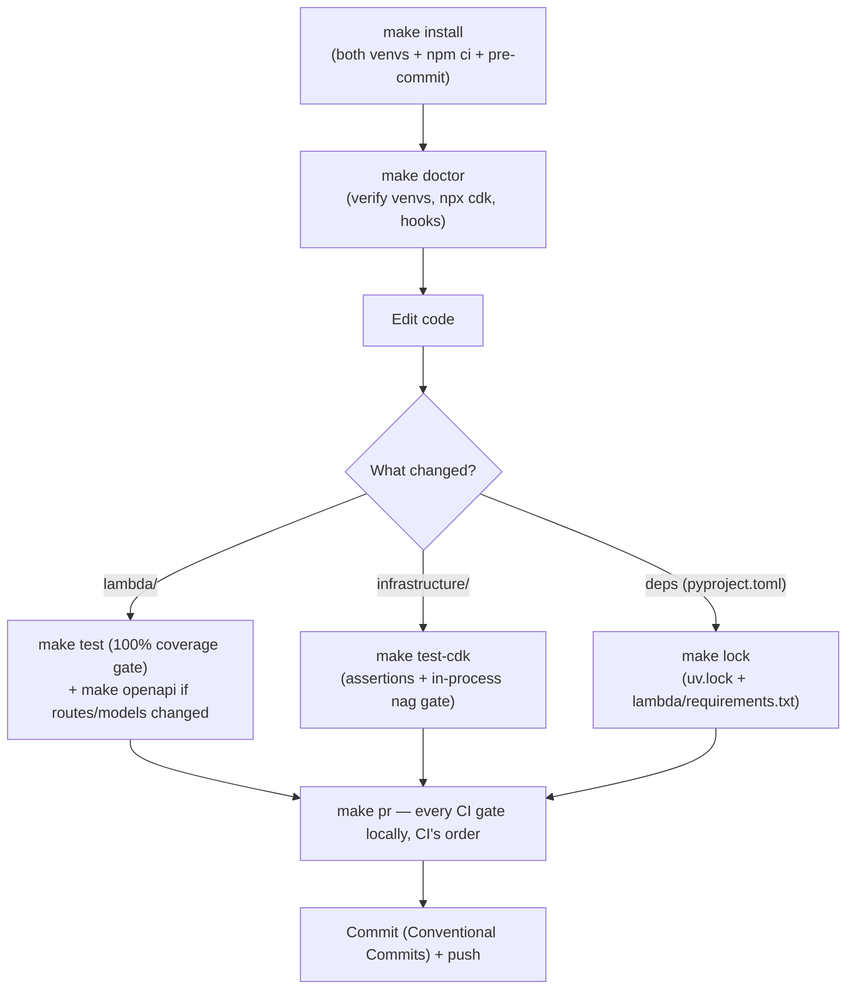
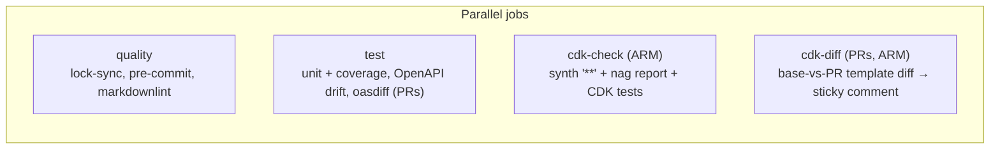
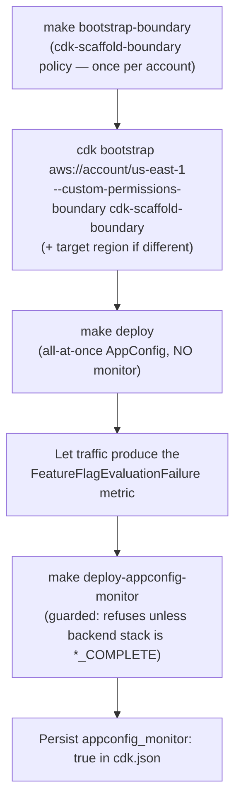
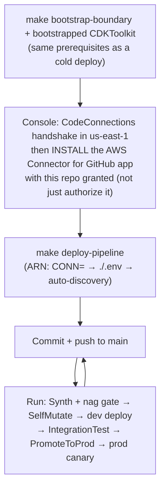
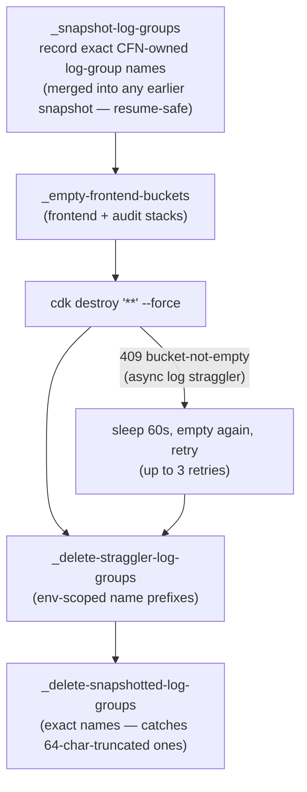
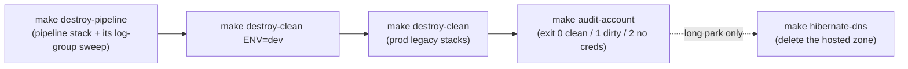

# Key Workflows

The processes a contributor (human or agent) actually runs, in the order they run them.

## Local development loop

Rules that keep the loop working:

- **Never mix the venvs**: `.venv` (CDK) and `.venv-lambda` (Powertools) hold incompatible `attrs` resolutions. The Makefile routes each target to the right venv via `UV_PROJECT_ENVIRONMENT`; follow it rather than running pytest/mypy directly. Recovery: `make clean-venvs && make install`.
- **Don't run `pytest tests/cdk` bare** — the project-wide `addopts` hardcodes a 100% `lambda/` coverage gate that only the unit suite satisfies; the make targets pass `--override-ini="addopts="`.
- **`make cdk-synth` needs Docker** (PythonFunction bundling). `make test-cdk` covers the nag gate without Docker (bundling skipped in-process); run the full synth before pushing IAM-touching code.
- **`make cdk-synth` covers only the direct (non-pipeline) shape.** The pipeline shape is gated in-process by `tests/cdk/test_pipeline_stack.py` (dummy account + connection ARN, part of `make test-cdk`) and for real by the pipeline's own Synth step.
- Commit messages follow the Conventional Commit grammar (`feat:` `fix:` `docs:` `chore:` `ci:` `test:` `refactor:` `build:`) — enforced on PR titles by `.github/workflows/pr-title.yml` and consumed by git-cliff. **No `Co-Authored-By:` trailers** (project preference).

## CI pipeline (per push / PR)

`make pr` mirrors quality + test + cdk-check locally. The cdk-diff job is hermetic (no AWS credentials — diffs two locally synthesized assemblies).

## Deployment workflows

### First (cold) deploy

`appconfig_monitor` on a cold deploy bricks the stack: the monitor's fresh alarm starts `INSUFFICIENT_DATA`, AppConfig treats that as a rollback signal, and the create aborts. `retain_data=true` is safe from the first deploy and belongs in `cdk.json` for production forks (CLAUDE.md's part-three plan sets it from the first deploy, because the audit bucket's Object Lock cannot be retrofitted). Skipping `make bootstrap-boundary` fails every role at deploy with an IAM error. Other fresh-account prerequisites (README "Fresh AWS account setup"): an applied Lambda concurrency quota of at least 200 (the function reserves 100), Cost Explorer enabled early (its data lags about a day, and `make audit-account` relies on it), and ambient credentials verified with `aws sts get-caller-identity` — nothing in the tooling passes `--profile`.

### CD pipeline (pipeline mode)

Rules of operation (README "CI/CD pipeline" holds the full runbook and the live-proven failure modes):

- **Push first, then any workstation `make deploy-pipeline`** — never the reverse; a workstation deploy restarts a run that sources `main` as it stands, and SelfMutate re-imposes the old definition if your change is unpushed. Most definition changes can simply ride self-mutation with no workstation deploy at all.
- **`dev` is pipeline-reserved** — never `make deploy ENV=dev`; pick any other name for an ephemeral copy.
- **Cold-deploy sequencing happens twice** (dev on the first run, prod on the first approved promotion): keep `appconfig_monitor` off until both environments' `FeatureFlagEvaluationFailure` metrics have reported, then set it in `cdk.json` (the pipeline reads the same file). Remove a pre-existing `appconfig_monitor: true` before the birth deploy.
- **A refused canary is recoverable by the next push**: the failed run leaves the backend stack in `UPDATE_ROLLBACK_COMPLETE`, which is updatable.
- **Diagnosing "pushes start nothing"**: check the GitHub app is *installed* with this repo granted, the `Triggers` block and `DetectChanges: false` (pinned by `test_push_trigger_is_explicitly_declared` / `test_source_is_the_codeconnections_repo`), then CloudTrail's `Username` on `StartPipelineExecution` and the execution's `trigger.triggerType` (`WebhookV2` is the only genuine push start).
- **Rotating the connection** = rerun `make deploy-pipeline` with the new connection resolvable.

### Ephemeral environments

`make deploy ENV=alice-feature-x` deploys a fully namespaced copy of all five stacks (validated env name, alarms page nobody). `make destroy-clean ENV=alice-feature-x` tears down only that environment — sweeps are env-prefixed by construction. `ENV=dev` is the one name to avoid (pipeline-reserved).

### Teardown (`make destroy-clean`)

Why: CloudFront/S3/CloudTrail log delivery is asynchronous (late files fail `DeleteBucket`; CloudFront standard logs can lag up to about an hour, so one retry was live-proven insufficient), and Lambda log delivery re-creates deleted log groups. The snapshot pass exists because CloudFormation truncates Lambda physical names at 64 chars mid-word, which no prefix can match; it merges rather than truncates so a re-run after a partial teardown keeps the names of stacks an earlier attempt already deleted. With `retain_data=true`, termination protection blocks destroying the data and audit stacks, and their `RETAIN` resources survive by design.

### Full lifecycle teardown and proof

`make audit-account` deletes nothing: it scans every enabled region for app-named stacks, log groups, CodeDeploy apps, Cognito user pools, and Cognito identity pools (plus global S3), prints Route 53 zones, domain registrations (with their auto-renew flag — the annual charge no `cdk destroy` ever reaches), and ACM certificates without failing on them, lists the expected survivors (`CDKToolkit`, `CdkScaffoldBoundary`, CodeConnections connections), and ends with Cost Explorer month-to-date by service as the ground truth.

### DNS hibernation (planned custom domain)

The hosted zone deliberately lives outside CloudFormation (a CDK-managed zone would force a registration name-server update on every redeploy). `make hibernate-dns` parks it: it needs `DOMAIN_NAME` in `./.env`, refuses while any us-east-1 `ServerlessApp*` stack is deployed (a narrower check than `audit-account`'s all-region scan), deletes everything except the apex NS/SOA, then deletes the zone. `make wake-dns` adopts or recreates the zone, re-points the registration's name servers, and rewrites `HOSTED_ZONE_ID` in `./.env`; deploy only after registry NS propagation settles, or ACM DNS validation stays pending. Nothing in the app consumes the zone yet — the custom-domain arc itself is unimplemented.

## Release workflow

1. `git cliff --bumped-version` decides the next version from Conventional Commits.
2. Bump `pyproject.toml`, run `make lock`.
3. `git cliff -o CHANGELOG.md` (Dependabot bumps and merge commits are filtered by `cliff.toml`).
4. One `chore:` commit; annotated `vX.Y.Z` tag whose body is the release notes.
5. Push the tag → `.github/workflows/release.yml` publishes the GitHub Release automatically.

Caveat: annotated tags `v3.0.1` (`b8bb5b2`) and `v3.0.2` (`8dd38d8`) now exist **locally only** — they give `git cliff --bumped-version` a baseline, but they have not been pushed, so `origin` still has no tags and `release.yml` has not run. Pushing them is a deliberate maintainer decision, since it publishes the two GitHub Releases (see review_notes.md).

## Dependency update workflow

- **Dependabot** bumps `pyproject.toml` + `uv.lock` (uv ecosystem), `package.json` (npm), workflow SHAs, and pre-commit `rev:`s — but never the exported `lambda/requirements.txt`, so CI's drift gate fails until `make lock` runs on the branch.
- **`make deps-merge`** (wraps `scripts/deps_merge.sh`) automates the loop per PR: rebase onto main → `make lock` → `ruff format` → commit → force-push → arm squash auto-merge. Sequential by design (each `make lock` regenerates `uv.lock`). Never force-merges through failing checks.
- **`make upgrade`** is the local path: `uv lock --upgrade` gated by a 7-day PyPI cooldown (`COOLDOWN_DAYS`) against fresh malicious releases, plus `pre-commit autoupdate` and `npm update` (which do **not** honor the cooldown — review their diffs).

## Adding a resource (infrastructure change)

1. Add the construct in the owning module (usually `BackendApp` or `FrontendStack`); follow the local pattern (explicit log group with retention, CMK where supported, removal policy on stateful resources — the `TemplateConventionChecks` Aspect fails synth otherwise).
2. Run `make test-cdk` — expect nag findings; fix the resource or add `acknowledge_rules` with a real rationale (granular IAM rules need exact `applies_to` finding ids, printed by the gate's failure output).
3. Update the snapshot tests if templates changed (`UPDATE_SNAPSHOTS=1 make test-cdk`, reviewed and paired with a fine-grained assertion); run `make cdk-synth` (Docker) before pushing IAM-touching changes.
4. If the service creates out-of-CFN supporting resources, mirror the cleanup custom-resource pattern (`RumLogGroupCleanup` / `AppInsightsDashboardCleanup`).
5. If the resource needs an AWS service outside the boundary's `AllowServiceActions`, extend `infrastructure/bootstrap/cdk-scaffold-boundary.json` and rerun `make bootstrap-boundary` — synth and cdk-nag cannot see the boundary, so the gap only surfaces at deploy or runtime.
6. Account- or region-wide constructs need explicit flagging (they mutate neighbors' state); a deploy region outside the pinned AppConfig extension layer map needs `-c appconfig_extension_layer_arn` (or a verbatim map entry).

## API change workflow

1. Edit routes/models in `lambda/app.py` / `lambda/models.py` (+ `service.py` logic).
2. `make test` (100% coverage gate — new branches need tests).
3. `make openapi` and **commit `docs/openapi.json`** — CI rejects drift; oasdiff rejects breaking changes on PRs.
4. If response shapes built outside the resolver change (the 400/409), keep the hand-built dicts and their documenting models in sync.
5. Browsers reach every route as `/api/<route>` through CloudFront — there is no CORS to configure, and the viewer-request rewrite plus `origin_path="/Prod"` map it onto the API Gateway path. Verify both the CloudFront path and the direct-URL 403 with `make test-integration` against a deployed environment.
